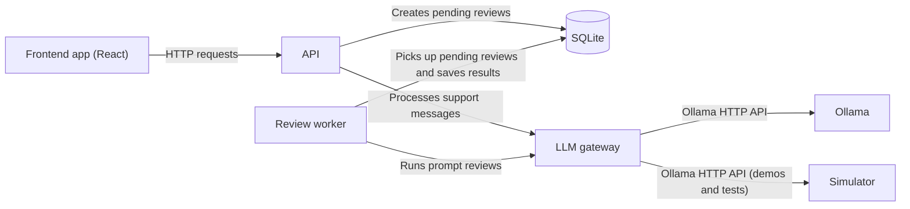

# AI Ticket Triage Service

## System overview

This service uses an LLM with structured output to triage support tickets. For each message, it returns a triage record with two fields, `intent` and `urgency`. Each version of the triage system prompt is stored separately in the database.

Prompt improvement runs in the background as a review. A call to `POST /reviews` creates a pending review in the database, and a separate worker picks it up. The review uses a more capable model as a judge to evaluate triage results and suggest a new prompt when it finds errors.

To try the service locally, open the demo console at [http://localhost:3000/](http://localhost:3000/).

Specs are in [docs/](docs/); architecture is in [docs/architecture.md](docs/architecture.md).

## Main components



### API

The API handles HTTP requests and reads from and writes to the database. `POST /process` triages a support message and returns its intent and urgency. `POST /reviews` creates a pending review in the database for the worker to pick up.

### Worker

The review worker runs in a separate process. It checks the shared database for pending reviews and runs them in the background.

### LLM provider and gateway

The API and the worker use the same LLM gateway to call the processing and judge models over HTTP. The gateway handles timeouts and retries, limits concurrent calls, and logs each call. It uses the same Ollama adapter for both Ollama and the simulator.

### Simulator

The simulator runs as a separate process and stands in for Ollama during demos and tests. `PUT /_provider` switches between the simulator and Ollama at runtime. The simulator's `/_sim/faults` endpoints let you add and clear faults such as timeouts, HTTP errors, and invalid model output.

### Database

The project uses a local SQLite database. It stores prompt versions, samples, and reviews, along with idempotency records and LLM call logs.

### Frontend app

A simple React console for trying out the service. It calls the API to triage support messages and start prompt reviews.

## Setup and run

### Install dependencies

You'll need `uv` and `pnpm`. From the repository root, run:

```bash
pnpm bootstrap
```

### Start the app

```bash
pnpm dev
```

### Try it out

Open the [React console](http://localhost:3000/) and submit a support message on the home page to see its intent and urgency.

With the simulator, use keywords like `billing`, `shipping`, or `technical issue` to get the matching intent. Add `urgent` or `ASAP` to get `high` urgency. For example, `I have a billing issue. Please help ASAP.` returns `billing` with `high` urgency.

Processed messages appear on the [Samples page](http://localhost:3000/samples). You can see all prompt versions on the [Prompts page](http://localhost:3000/prompts). The first prompt version is created automatically.

Use the [Simulator page](http://localhost:3000/simulator) to try different failure scenarios. On the [Reviews page](http://localhost:3000/reviews), you can see previous reviews and start a new one.

### Try the API with curl

Send a support message to `POST /process`:

```bash
curl -X POST http://localhost:4000/process \
  -H 'Content-Type: application/json' \
  -d '{"message":"Please help with my subscription cancellation ASAP."}'
```

With the simulator and the initial prompt, this returns `other` with `high` urgency. The sample gives the judge an example it can use to improve the prompt.

Start a prompt review with `POST /reviews`:

```bash
curl -X POST http://localhost:4000/reviews
```

The API returns a `review_id`. The worker runs the review in the background, and you can follow it on the [Reviews page](http://localhost:3000/reviews).

### Development

Run tests:

```bash
pnpm test
```

Run static checks:

```bash
pnpm lint
```

## Failure scenarios

### Processing

- **The model server times out or returns a temporary error.** The LLM gateway retries within the request deadline. If the server stays unavailable, the circuit breaker opens and new requests fail fast with `503`.
- **The model returns invalid output.** The gateway checks the output against the triage schema and retries if validation fails. If the output is still invalid after the retries, the API returns `502`.
- **The client sends the same request twice.** With the same `Idempotency-Key` and request body, the API returns `409` while the first request is running. Once the result is saved, a retry returns the stored response. This also covers a crash after the database commit but before the client receives the response.

### Prompt reviews

- **The worker crashes during a review.** The worker saves each model result in the database. Once the previous worker's lease expires, the review can resume from the first unfinished step.
- **The model server stays unavailable during a review.** The worker retries the review later with increasing delays. If the review stays open past its time limit, it is marked as failed.

## Trade-offs

### Processing

#### Retries

**Pros**

- Help `POST /process` recover from temporary provider failures within a single request.
- Keep client code simpler and save another round trip to the API when a retry succeeds.

**Cons**

- Can increase response time. The gateway limits both the number of attempts and the total request time.
- Add retry logic to the service.

#### Idempotency

**Pros**

- Returning a saved response for the same `Idempotency-Key` and request body avoids another model call and makes the retry faster.
- Idempotency records make it easier to see how retries were handled.

**Cons**

- Adds a database table and logic to track which process owns the request.
- If the API crashes before saving the result, retries can get a `409` until the lease expires. Once it expires, a retry may call the model again, even if the model already answered.

#### Circuit breaker and readiness

**Pros**

- Returns `503` quickly during a provider outage, reducing delays for clients and other services waiting on the API.
- Avoids sending calls while the circuit is open, which can reduce model costs.

**Cons**

- Adds state and recovery logic.
- The API may keep returning errors briefly after the model server recovers. After a cooldown, the breaker enters the half-open state and lets one call through to check for recovery.

`/readyz` checks the database and schema, so the API can stay ready while the breaker is open.

#### Concurrency limits

**Pros**

- Limit how many calls reach the model server at once. Extra processing requests wait for a slot within their request deadline.
- Give processing and reviews separate pools, so a review cannot take a processing slot.

**Cons**

- Add queueing and configuration to the gateway.
- A limit set too low can make requests wait while the provider still has capacity.

#### Request and LLM call logs

**Pros**

- Request IDs link API requests to individual model attempts, making errors and slow responses easier to debug.
- Token counts help estimate model costs.

**Cons**

- Logging each attempt means more data to store.

### Prompt reviews

#### Separate review worker

**Pros**

- The API and worker can be deployed and scaled independently. The current design runs one review at a time.
- The API can still triage messages if the worker goes down. Pending reviews stay in SQLite until a worker picks them up.

**Cons**

- The API and worker need to coordinate through the shared database.
- There is an extra process to deploy, monitor, and restart.

#### Saving intermediate results

**Pros**

- The worker can reuse saved results after a restart and avoid repeating those model calls.
- Review progress is visible while the worker is still running.

**Cons**

- Saving progress after each result adds database writes and transactions.

#### Keeping the review simple

The assignment calls for a simple prompt improvement process. A small set of samples is quick to review and easy to inspect. The judge scores the candidate on the same samples used to create it, so the score gives limited confidence about how the prompt will handle new tickets.

#### Running the workflow in the worker

The assignment rules out external services, so the worker uses SQLite to track review progress and handle retries and recovery. In production, a workflow engine like Temporal could take over that logic and would add another system to deploy and operate.

## AI tooling

I used Claude Code for most of the project. I also used ChatGPT and Codex for independent research and review.

### Spec-driven development

I started by writing the specs in [docs/specs](docs/specs/). The `write-spec` skill helped me structure them, and the `plan-challenger` subagent helped me spot gaps and question assumptions before I started coding.

### Skills and subagents

I use skills and subagents for independent reviews, with `CLAUDE.md` defining when to run them. Each subagent has its own instructions and context. This keeps the main conversation focused and gives the reviewer a fresh look at the work.

Before I do my own QA pass, `qa-reviewer` uses Claude's built-in browser to test the main flow against the running app. When a change writes to the database, the agent also checks what was saved.

I also added the official skill bundled with FastAPI.

## Planning

I use plan mode for larger features. For example, I used the finished processing spec to plan and implement `POST /process` in one pass. I use `plan-challenger` to question the approach before implementation. I also configured Claude Code to ask me about unclear requirements before it starts writing code.

## Total time

I spent about 7 hours on the project. That includes preparation, writing the specs, building and testing the service, saving the project artifacts, and publishing it on GitHub.
