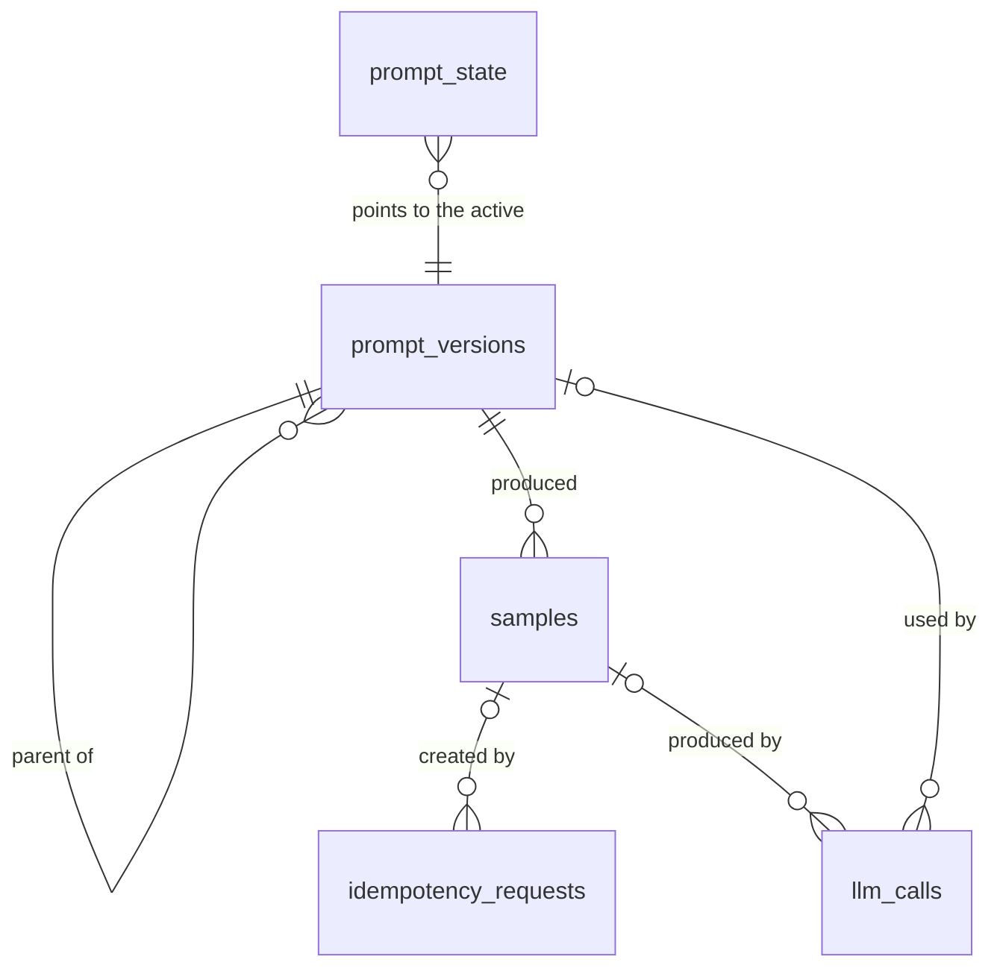

# AI Ticket Triage Service: Processing

## Overview

Other backend services post one customer message and get back a validated triage record - the message's intent and urgency - produced by an LLM under a stored, versioned prompt. Callers reach the service over networks that lose requests and responses. The models run in a separate server, Ollama, which can be down, still loading a model, or slower than the traffic, and which sometimes answers with something that is not a triage record. The process may be killed at any moment. Whatever fails, a caller gets a validated record or a classified error that says whether to retry, a retried request is processed once, and what happened to any request can be found afterwards.

The prompt improves through reviews, which are specified in [prompt-improvement.md](prompt-improvement.md).

## Goals and Non-Goals

### Goals

- Return a validated triage record, or a classified error that says whether a retry can help
- Process a request repeated with the same idempotency key once
- Contain provider failures: bounded retries inside a deadline and fast failure during an outage
- Make every request traceable by id

### Non-Goals

- Quality of the triage
- Caller authentication and multi-tenancy
- Streaming and batch endpoints
- Retention and deletion of stored data

## Functional Requirements

### FR-1: Processing a Message

- `POST /process` SHALL accept one message of 1 to 4,000 characters (configurable) and return a triage record, the stored sample's id, the prompt version used, and the request id. Other input SHALL be refused with HTTP 422 before any model call.
- A triage record SHALL have exactly: `intent` (`billing`, `shipping`, `technical_issue`, `account`, `cancellation`, `other`), and `urgency` (`low`, `normal`, `high`).
- The model SHALL be asked for output constrained to this schema, and the service SHALL validate whatever comes back. An invalid output SHALL never be returned or stored.
- The content of the prompt version (FR-2) SHALL be sent as the system prompt, if the model supports one.
- The message SHALL be sent as user content and SHALL NOT be interpolated into the prompt.
- A request SHALL use the prompt that was active when it started, to its end.
- The sample, the result of its LLM call, and the completion of its idempotency record SHALL be committed in one transaction, before the response is sent. A failed request stores no sample.
- Every response SHALL carry the request id. An error SHALL have a machine-readable code and a `retryable` flag, and SHALL NOT contain a model server's response or a stack trace.

### FR-2: Prompt Versions

- The prompt SHALL be the instruction text given to the processing model, stored in the database. A migration seeds version 1 with the reason `Initial prompt`.
- A version SHALL be immutable and record its parent and the reason for the change.
- Exactly one version SHALL be active. It SHALL change only through a promotion ([Prompt Improvement FR-2](prompt-improvement.md#fr-2-review-steps)).
- A version's status SHALL be `active`, or `superseded` for an earlier active version. The statuses of a candidate are in [Prompt Improvement FR-2](prompt-improvement.md#fr-2-review-steps).

### FR-3: Idempotent Requests

- `POST /process` SHALL accept an optional `Idempotency-Key` header. Without one, a retry is processed again and stores a second sample.
- A key is scoped to its endpoint and stored with a hash of the request body. The hash SHALL be taken over the parsed body in canonical form - keys sorted, no insignificant whitespace - so bodies that differ only in formatting count as the same request. A key is not scoped to a caller, because there are none (Non-Goals); FI-3 covers adding one:

  | Stored state | Outcome |
  |---|---|
  | No record | The request claims the key with a lease and executes |
  | `processing`, lease valid | HTTP 409 `request_in_progress` with `Retry-After` |
  | `processing`, lease expired | The request takes the key over and executes |
  | `completed` | The stored response is replayed with `Idempotent-Replayed: true`; nothing is executed |
  | `retryable_failed` | The request claims the key with a new lease and executes again |
  | `failed` | The stored error is replayed |
  | Any state, different body | HTTP 422 `idempotency_key_reused` |

- Claiming or taking over a key SHALL be a single atomic write that succeeds for one request only; a request that loses the race is answered as if it had found the key `processing` with a valid lease.
- A replay SHALL return the stored status and body. Its headers are those of the replaying request - its own `X-Request-ID`, plus `Idempotent-Replayed: true` - not those of the original response; no stored response relies on any other header.
- Only the holder of a lease SHALL write the outcome. The lease lasts 30 seconds by default.
- A `/process` request with a key SHALL run to completion after its caller disconnects, so the retry receives the stored result.
- Records SHALL be removed after 24 hours (configurable).

### FR-4: Provider Failure Handling

- Every failed model call SHALL be classified:

  | Failure type | Cause | Retried | `/process` answers |
  |---|---|---|---|
  | `ProviderUnavailable` | Connection refused, network error, timeout, 5xx, 429 | Yes, inside the deadline | 503, `Retry-After` |
  | `OutputInvalid` | HTTP success, but the output is not valid JSON, violates the schema, or was cut off at the token limit | Yes | 502 |
  | `ProviderRejected` | The server refuses the request as sent (another 4xx) | No | 422, not retryable |
  | `ProviderMisconfigured` | 404: the configured model is not installed | No; opens the breaker at once | 503, `Retry-After` |
  | `DeadlineExceeded` | The request deadline passed (NFR-2) | - | 504 |
  | `CircuitOpen` | The breaker for the model is open (NFR-3) | - | 503, `Retry-After` |

- Every failure except `ProviderRejected` SHALL be answered as retryable and leave its idempotency record `retryable_failed`. `ProviderRejected` is decided by the request itself, so it SHALL be stored as `failed` and replayed.
- When a `Retry-After` from the model server does not fit in what is left of the deadline, the request SHALL fail at once and pass it on to its caller.

### FR-5: Process Lifecycle

- Work in flight SHALL be owned through a lease in the DB, never through a process lock, so a process SHALL NOT take over at startup what another process may still own, and a second process of a role MAY run on the same database. A crashed process's work SHALL be taken over once its lease expires: an idempotency record left `processing` as in FR-3, a review as in [Prompt Improvement FR-3](prompt-improvement.md#fr-3-crash-recovery).
- LLM calls left `running` that belong to no review SHALL be closed as errors with the code `interrupted` once they are older than the request deadline, so no call still in flight is closed. The API SHALL check at startup and every minute. None of this SHALL delay `/process`.
- On a termination signal the API SHALL stop accepting requests and let requests in flight finish within 25 seconds; the worker SHALL stop after its call in flight, cancelling that call when the 25 seconds are over.
- Migrations SHALL run in one immediate transaction that checks the schema version before applying anything, so processes starting together apply them once.
- A process SHALL refuse to start on a schema newer than its code. A running worker that finds the schema newer than its code SHALL stop as on a termination signal and exit with a non-zero code, so its supervisor starts it again on the new code. A process SHALL NOT restart itself.

### FR-6: Health Checks

- The API SHALL serve `GET /healthz`, answering 200 while the process is up, and `GET /readyz`, answering 200 when the DB is reachable and migrations are applied, and 503 otherwise.
- `/readyz` SHALL NOT depend on the worker or the model server: `/process` is served without a worker, and an outage is handled by the breaker (NFR-3). Neither endpoint SHALL make a model call.

## Non-Functional Requirements

### NFR-1: Durability

- State that must survive a restart SHALL live in the DB, with full synchronous commits, so a success response means the data is on disk. The breaker, limits, and the provider choice (NFR-5) MAY be lost.
- No transaction SHALL be open while a model call is in flight, and database work SHALL NOT block the event loop.
- A restart SHALL NOT cause a stored result to be computed again (CON-1).

### NFR-2: Timeouts and Retries

- The LLM gateway (NFR-5) SHALL be the only place that retries; an adapter and its client SHALL NOT.
- `/process` SHALL answer within a request deadline of 20 seconds, whatever the model server does: at most 3 attempts, with a jittered wait that starts at 0.5 seconds and doubles. An attempt gets the smaller of 8 seconds and the time left.
- A `Retry-After` from the model server SHALL replace the wait before the next attempt, as given, without jitter. For `/process` it has to fit in the deadline (FR-4).
- An attempt's timeout SHALL start when the call leaves the service, not while it waits in its pool, and a timed-out attempt SHALL close its connection.
- The idempotency lease and the shutdown grace period SHALL be longer than the request deadline. Every number here is configurable.

### NFR-3: Load and Isolation

- `/process` calls SHALL run at most 2 at a time per process (default, configurable); a request beyond that waits for a slot within its deadline.
- Each model SHALL have a circuit breaker that counts the attempts that reached the model server. It opens for 15 seconds after 5 attempts in a row got no answer (`ProviderUnavailable`, or an attempt cut short by the request deadline), and at once on `ProviderMisconfigured` (FR-4). Any answer from the server - a record, an invalid output, a rejection - resets the count. While it is open, calls fail at once as `CircuitOpen` and are not counted; then one trial call decides: an answer closes the breaker, no answer opens it again.
- Pools and breakers SHALL be per process.

### NFR-4: Observability

- **Request id.** An `X-Request-ID` header is used as given, otherwise the service generates one. It SHALL be returned with every response, written on every log line, and stored with the sample the request created and with every LLM call made for it.
- **Logs.** One JSON object per line on standard output. A finished request SHALL log its route, status, duration, error code, sample id, prompt version, and idempotency outcome.
- **LLM call log.** Every attempt of every model call SHALL be recorded with its operation (`process`, or a review operation of [Prompt Improvement NFR-3](prompt-improvement.md#nfr-3-review-observability)), model, attempt number, status, tokens, duration, and error. It SHALL be written as `running` before the call and closed after it, so a call in flight when the process died stays visible.
- Message text, outputs, and prompt text SHALL NOT appear in logs or the LLM call log.

### NFR-5: Models

- **LLM gateway.** Every model call SHALL go through one operation: a model, a prompt, user content, and an output schema go in; a validated object with token usage, or a classified failure (FR-4), comes out. Timeouts, retries, limits, the breaker, and the call log SHALL sit above the adapters.
- **Provider.** The provider SHALL be one of two profiles, `ollama` or the test model server of [simulator.md](../simulator.md), each with a base URL, a processing model, and a judge model, and both reached through the one Ollama adapter. It is switched at runtime as described there. A request keeps the provider it started with.
- **Ollama.** The `ollama` profile reaches Ollama at `http://localhost:11434` by default, with the processing model `qwen3:0.6b`. Choosing Ollama does not check that the models are installed: a missing model fails its requests (FR-4).
- **Model settings.** Every call SHALL set: thinking off; temperature 0 and a fixed seed; a limit on output tokens; and the context window, 8,192 tokens for the processing model by default. The context window SHALL cover the longest prompt and message the service accepts, because Ollama cuts longer input off without an error.
- **Warm model.** The processing model SHALL be loaded in the background when Ollama becomes the provider and kept loaded (on by default, configurable). The warm-up is a load request with no prompt, not a model call, so it is outside the LLM gateway: it takes no pool slot, does not count on the breaker, is not retried, and is not in the LLM call log. A failed warm-up is only logged.

## Constraints (Externally Imposed)

- **CON-1 - No idempotency in the model server.** A crash between a model answering and the result being committed repeats that call: one per crash.

## Error Scenarios

| Scenario | Outcome |
|---|---|
| The model server fails or times out during `/process` | Retried inside the deadline. If no attempt succeeds: 503 or 504, retryable, no sample |
| The model's output fails validation | Retried. If it stays invalid: 502, no sample |
| The model server stays down | After 5 failures in a row the breaker opens; requests fail at once with 503 until a trial call gets an answer |
| The configured model is not installed | A call that reaches the model server fails: `/process` answers 503 with `Retry-After`, the breaker opens at once, and an error is logged |
| More requests arrive than the model can answer | They wait for a slot; a request that gets none before its deadline gets 504 |
| A caller's connection drops and it retries with the same key | The first request completes; the retry gets 409 while it runs, then the stored response. One call, one sample |
| The same key arrives with a different body | 422; nothing is executed |
| The API dies during `/process` | No sample. A retry gets 409 until the key's lease expires, then executes |
| No worker is running | `/process` is served |
| A second API or a second worker is started on the same database | Both run. Each request and each review is executed by one of them only, the one holding its lease |

## Acceptance Criteria

Each criterion starts from an empty database with the seeded prompt as version 1, the [deterministic test model server](../simulator.md) as provider, and no faults. The harness shortens timeouts and waits.

### AC-1: A Message Becomes a Validated, Traceable Record

**When** a billing message is posted with an `X-Request-ID`.

**Then** the response has intent `billing`, prompt version 1, the request id, and a sample id. The DB holds the sample and one successful `process` call, both with that request id, the call with tokens and duration. The log has one line for the request, with that id and without the message text.

### AC-2: A Retried Request Is Processed Once

**When** a request is posted twice with the same key.

**Then** the responses are identical, the second marked as replayed; one sample exists and the LLM call log has one `process` call.

**When** a request is posted with a second key, the model server delays its answer, and the caller disconnects before it and retries with that key.

**Then** the retry gets 409 while the first request runs, then the stored record. For that key there is one sample and one call.

**When** the first key is posted again with a different message.

**Then** the response is 422 and no new LLM call is recorded.

### AC-3: Provider Failures Are Bounded and Classified

**When** a message is posted with one of these faults, each tried on its own with the breaker closed: every call answers 5xx; every call violates the schema; every call never answers; every call answers 429 with a `Retry-After` beyond the deadline; every call is rejected.

**Then** the responses are, in order: 503 after 3 attempts; 502 after 3 attempts; 504; 503 after 1 attempt with the server's `Retry-After`; 422 after 1 attempt. Every attempt is recorded as an LLM call, no failure stores a sample, and each is answered within the deadline.

### AC-4: An Outage Fails Fast and Overload Waits Within the Deadline

**When** every call answers 5xx and messages are posted until 5 calls in a row have failed.

**Then** the next request gets 503 at once, as `CircuitOpen`. After the fault is cleared and the open interval has passed, a message is processed.

**When** the pool allows 2 calls, the model server delays each answer by less than an attempt's timeout, and 10 messages are posted at once.

**Then** every request returns a record or, once its deadline has passed, 504; none returns 429. No more than 2 `process` calls in the LLM call log overlap in time.

### AC-5: Health Checks Report the API Alone

**Given** the API runs with no worker and every model call answers 5xx.

**When** `/healthz` and `/readyz` are called.

**Then** both answer 200, and no LLM call is recorded.

**When** the database cannot be reached.

**Then** `/healthz` answers 200 and `/readyz` 503.

## Security Considerations

- There is no authentication: anyone who can reach the service can call it.
- Customer messages never leave the machine, but they are stored verbatim, so the database file is sensitive. Logs and the LLM call log carry ids, sizes, and codes only.
- A message is untrusted input. It is sent as user content and the output is constrained to the schema, so the worst a crafted message achieves is a wrong record. Both fields, `intent` and `urgency`, are closed enums, so no input text reaches the record.

## Future Improvements

- **FI-1: A DB with several writers.** It would allow several API processes and processes on more than one host. Leases would work as they are; limits and breakers would need a store shared between processes.
- **FI-2: Metrics.** The API would expose `GET /metrics` in Prometheus format: HTTP requests and durations by route and status; idempotency outcomes; `/process` LLM calls, durations, tokens, and retries by model; breaker state; calls in flight and waiting per pool; the active prompt version. Ids would never be labels, and message text, outputs, and prompt text would never appear. Review metrics are in [Prompt Improvement FI-1](prompt-improvement.md#future-improvements).
- **FI-3: Idempotency keys per caller.** Once callers are authenticated, a key would be scoped to the caller as well as the endpoint, so two callers choosing the same key never see each other's response. The caller's id would join the primary key of `idempotency_requests`.

## Appendix: Schema

The starting schema for the DB.

Conventions used below:

- **Timestamps** are ISO 8601 UTC text, such as `2026-11-25T10:00:00.000Z`. A `created_at` or `updated_at` defaults to the time of insert.
- **JSON** columns are checked to hold valid JSON. `model_config` holds JSON too but is not checked.
- **→ table** is a foreign key. **Required** means `NOT NULL`.

The review tables and their links are in [Prompt Improvement Appendix: Schema](prompt-improvement.md#appendix-schema).

### `prompt_versions`

Every version of the prompt. A row is never changed (FR-2). A version's status is not stored: it follows from `prompt_state` and [`reviews`](prompt-improvement.md#reviews).

| Column | Type | Required | Notes |
|---|---|---|---|
| `id` | integer | yes | Primary key |
| `parent_id` | integer | | → `prompt_versions`. The version this one was derived from; empty for version 1 |
| `content` | text | yes | The instruction text |
| `change_reason` | text | yes | Why it changed |
| `created_at` | timestamp | yes | |

### `prompt_state`

Exactly one row, with `id` 1: which version is active.

| Column | Type | Required | Notes |
|---|---|---|---|
| `id` | integer | yes | Primary key; always 1 |
| `active_version_id` | integer | yes | → `prompt_versions` |
| `updated_at` | timestamp | yes | |

### `samples`

A processed message and the validated record returned for it.

| Column | Type | Required | Notes |
|---|---|---|---|
| `id` | text | yes | Primary key |
| `request_id` | text | yes | The request that created it |
| `prompt_version_id` | integer | yes | → `prompt_versions`. The prompt that produced the record |
| `input` | text | yes | The message |
| `output` | JSON | yes | The triage record |
| `provider` | text | yes | The provider profile: `simulator` or `ollama` |
| `model` | text | yes | The processing model |
| `model_config` | text | yes | The model settings of the call; defaults to `{}` |
| `created_at` | timestamp | yes | |

Indexed by `(prompt_version_id, created_at)` for sample selection, by `created_at`, and by `request_id`.

### `idempotency_requests`

One record per idempotency key (FR-3). The primary key is `(endpoint, key)`.

| Column | Type | Required | Notes |
|---|---|---|---|
| `endpoint` | text | yes | |
| `key` | text | yes | The `Idempotency-Key` header |
| `request_hash` | text | yes | A hash of the canonical request body (FR-3) |
| `status` | text | yes | `processing`, `completed`, `retryable_failed`, or `failed` |
| `sample_id` | text | | → `samples` |
| `owner_token` | text | | The lease holder |
| `lease_expires_at` | timestamp | | |
| `response_status` | integer | | The stored HTTP status |
| `response_body` | JSON | | The stored response body, replayed to a retry. Headers are not stored (FR-3) |
| `created_at`, `updated_at` | timestamp | yes | |

Indexed by `created_at`, for removing old records.

### `llm_calls`

One row per attempt of a model call (NFR-4). For a `process` call, `sample_id` stays empty until the sample is written, in the same transaction that closes the call.

| Column | Type | Required | Notes |
|---|---|---|---|
| `id` | text | yes | Primary key |
| `request_id` | text | yes | |
| `sample_id` | text | | → `samples` |
| `review_id` | text | | → [`reviews`](prompt-improvement.md#reviews) |
| `prompt_version_id` | integer | | → `prompt_versions` |
| `operation` | text | yes | `process`, or a review operation of [Prompt Improvement NFR-3](prompt-improvement.md#nfr-3-review-observability) |
| `provider` | text | yes | |
| `model` | text | yes | |
| `provider_request_id` | text | | The model server's id for the call |
| `attempt` | integer | yes | Defaults to 1 |
| `status` | text | yes | `running`, `success`, `error`, or `timeout` |
| `input_tokens`, `output_tokens` | integer | | |
| `duration_ms` | integer | | |
| `error_code`, `error_message` | text | | |
| `created_at` | timestamp | yes | |
| `completed_at` | timestamp | | |

Indexed by `request_id`, by `review_id`, and by `created_at`.
