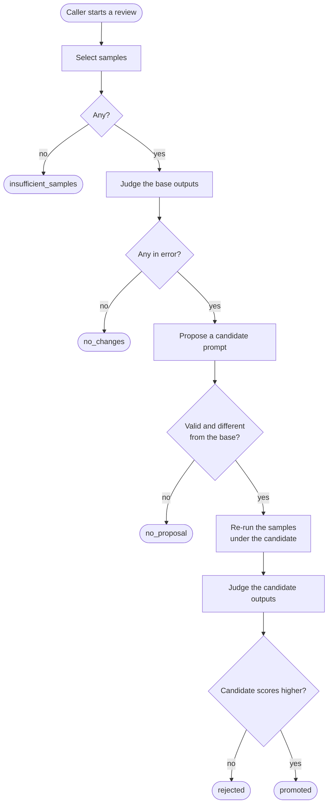
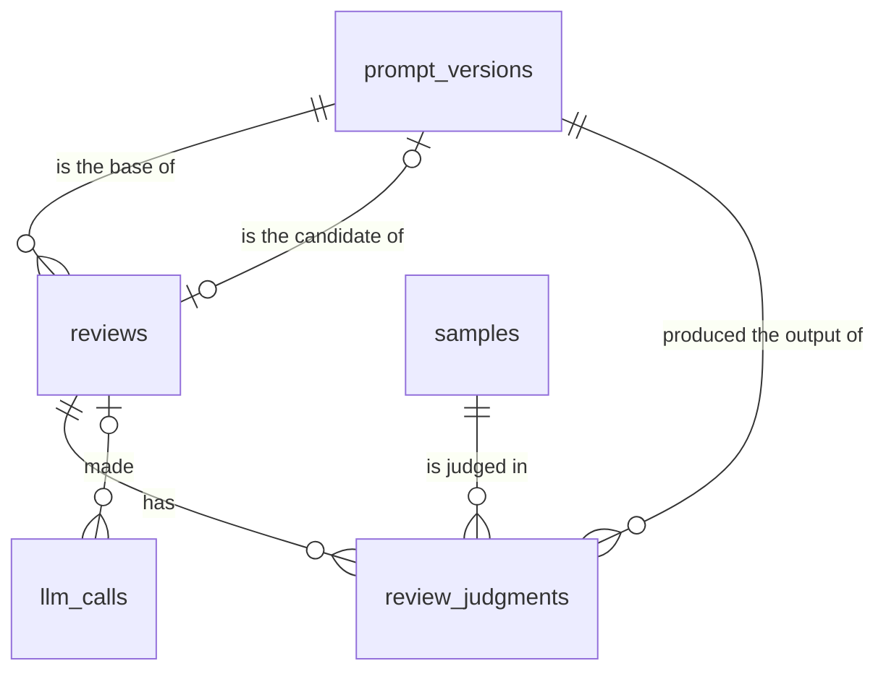

# AI Ticket Triage Service: Prompt Improvement

## Overview

The triage service of [processing.md](processing.md) classifies messages under a stored, versioned prompt. A review tries to improve that prompt. A caller starts a review and gets its id back at once; the worker process runs it in the background:

1. Take the most recent samples of the active prompt, at most 10.
2. The judge model judges each stored output.
3. If any is wrong, the judge proposes a new prompt.
4. The processing model answers every sample again under the new prompt.
5. The judge judges each new output.
6. The new prompt becomes active only if it scores higher than the current one; on a tie the current prompt stays.

Every model result is stored in the database as it arrives, so a review interrupted by a crash continues where it stopped.

## Goals and Non-Goals

### Goals

- Run reviews in the background, and survive a crash at any point of one without repeating a stored result
- Promote a prompt only when it scores higher, and keep every version with its parent and reason

### Non-Goals

- Quality of the proposed prompts
- Scoring a prompt on samples it was not written from
- Manual activation, editing, or rollback of a prompt
- Scheduled reviews, and cancelling or following a review through the API

The non-goals of [processing.md](processing.md#non-goals) apply here too.

## Functional Requirements

### FR-1: Starting a Review

- `POST /reviews` SHALL create a review and return HTTP 202 with its id. It SHALL only write to the database, so it works while no worker runs; the review stays `pending` until a worker claims it.
- A review SHALL freeze at creation its base prompt (the active version), the provider, both models, the sample limit, and the model settings, and use them to its end.
- At most one review SHALL be open, that is `pending` or `running`. While one is, `POST /reviews` SHALL be refused with HTTP 409 `review_in_progress`, retryable, with the open review's id.
- A review's status SHALL be `pending`, `running`, `completed` with an outcome, or `failed` with an error. The last two are final.

### FR-2: Review Steps

A judgment belongs to one sample under one prompt version. Judging is the same task for the base prompt's outputs and the candidate's.

- **Select.** The samples SHALL be the most recent samples, up to 10 (configurable), that the base prompt produced with the review's provider, processing model, and model settings, and that were not selected by a completed review. With no such sample the review SHALL complete as `insufficient_samples`. The selection SHALL be written in one transaction, each sample with its output as the base output.
- **Judge.** For each output, the judge model SHALL be given the message and the output, and SHALL return the record it considers correct and an explanation. An output is in error when it differs from that record in any field. A judge call ending as `OutputInvalid` or `ProviderRejected` SHALL mark the output unjudgeable; an unjudgeable output is not in error. With no base output in error the review SHALL complete as `no_changes`.
- **Propose.** The judge model SHALL be given the base prompt and the samples in error, each with its message, its output, and the correct record. Samples in error are taken most recent first, for as long as their messages total at most 6,000 characters; the rest are not shown, but are still re-run and judged. The judge SHALL return a new prompt of at most 4,000 characters and the reason for the change, of at most 500. The output schema carries both limits, so a longer answer ends as `OutputInvalid`. NFR-2 justifies the three numbers. The candidate SHALL be stored as a version whose parent is the base prompt, linked to the review. A proposal call ending as `OutputInvalid` or `ProviderRejected`, or a proposal identical to the base prompt, SHALL complete the review as `no_proposal` without storing a version.
- **Re-run.** For every sample, the review SHALL obtain the candidate's output with the processing model and the frozen model settings, never the judge model. A re-run SHALL NOT create a sample. A call ending as `OutputInvalid` or `ProviderRejected` SHALL be stored as a missing output, which is not judged.
- **Score.** Fields SHALL be compared exactly for `intent` and `urgency`. An output's points are its number of fields equal to the record its own judgment returned; a missing output has zero. A sample with an unjudgeable output, base or candidate, SHALL be left out. A prompt's score is the sum of its outputs' points.
- **Decide.** The candidate SHALL be promoted only if its score is higher than the base prompt's; otherwise the review SHALL complete as `rejected` and the base prompt stays active. A tie is not higher: with equal scores the base prompt stays. Switching the active pointer to the candidate and completing the review as `promoted` SHALL be one transaction.
- **Candidates.** A candidate SHALL be stored whether or not it is promoted. Its status SHALL be `candidate` while its review is open, `rejected` when its review completed without promoting it, or `abandoned` when its review failed before deciding.

A call that still ends as `OutputInvalid` or `ProviderRejected` after its attempts (NFR-1) is final: calls are deterministic ([Processing NFR-5](processing.md#nfr-5-models)), so a later attempt of the review would get the same answer. It never fails the review: each step above says what is stored instead.

### FR-3: Crash Recovery

- Each result of a model call - a judgment or unjudgeable mark, the candidate, a candidate output - SHALL be committed to the database in the same transaction that closes the LLM call that produced it. Nothing a review needs to continue is kept only in memory.
- A review SHALL be executed in attempts; every time the worker claims it counts as one. An attempt SHALL continue at the first step whose results are not all stored and skip every stored result: it SHALL NOT select again, judge an output twice, propose a second candidate, re-run a sample twice, or promote twice.
- An attempt that ends early, for any reason, SHALL record its error and send the review back to `pending`, to be tried again after a wait that starts at 1 minute and doubles with each attempt, up to 15 minutes. The reasons are the worker's process dying (`interrupted`), a termination signal to the worker (`terminated`), a model server unavailable beyond the retries of NFR-1 (`provider_unavailable`, `circuit_open`), and any other error (`internal_error`).
- A review SHALL end as `failed`, with its last error, at once on `ProviderMisconfigured`, and with `review_expired` when it has been open for 24 hours (configurable). Its samples are not used up, so a new review selects and judges them again.
- While an attempt runs, the worker SHALL hold a lease on the review, 60 seconds long and renewed every 20 seconds (configurable). Claiming a review, or ending the attempt of one whose lease expired, SHALL be a single atomic write that succeeds for one worker only, and only the lease holder SHALL write the review or its results.
- A review left `running` whose lease has expired SHALL be treated as an attempt ended with `interrupted`, and its LLM calls left `running` SHALL be closed as errors with the code `interrupted`, in the same transaction. None of this SHALL delay `/process`.
- How the worker stops on a termination signal or a newer schema is specified in [Processing FR-5](processing.md#fr-5-process-lifecycle).

## Non-Functional Requirements

These add to the non-functional requirements of [processing.md](processing.md#non-functional-requirements).

### NFR-1: Review Calls

- A review call SHALL get at most 6 attempts of 30 seconds, with a jittered wait that starts at 2 seconds and doubles up to 60. A `Retry-After` from the model server replaces the wait as in [Processing NFR-2](processing.md#nfr-2-timeouts-and-retries).
- Review calls SHALL run at most 1 at a time (default), in a separate pool, so a review cannot take a slot of `/process`. A review's re-run calls use the processing model and count on its breaker ([Processing NFR-3](processing.md#nfr-3-load-and-isolation)).
- Sample selection and finding the open review SHALL be served by indexes.
- Every number here is configurable.

### NFR-2: Judge Model

- The judge model SHALL default to `qwen3:8b`, with a context window of 16,384 tokens; its other settings are those of [Processing NFR-5](processing.md#nfr-5-models).
- Every review call SHALL fit in its model's context window, because Ollama cuts longer input off without an error, and a review would then judge or propose from text it never saw whole. The limits of FR-2 guarantee this. They are counted in characters, which the service can check, and sized for the worst case of one token per character; typical text takes a quarter to a third of that.

  | Call | Window, in tokens | Largest content, in characters |
  |---|---|---|
  | A re-run, as for `/process` | 8,192 (processing model) | Prompt 4,000 + message 4,000, leaving about 190 for the record |
  | A proposal | 16,384 (judge model) | Base prompt 4,000 + messages 6,000 + new prompt and reason 4,500, leaving about 1,880 for the instructions and the records |
  | A judgment | 16,384 (judge model) | Message 4,000 + two records; never near the window |

- Every prompt version is therefore at most 4,000 characters: the seeded one by construction, a candidate by the limit of FR-2. The message limit is that of [Processing FR-1](processing.md#fr-1-processing-a-message).
- The numbers are configurable, but only together: a larger limit needs a larger window.

### NFR-3: Review Observability

- The request id ([Processing NFR-4](processing.md#nfr-4-observability)) SHALL be stored with the review a request created and with every LLM call of that review.
- A review SHALL log every step it starts, every attempt that ended early, and its outcome or failure.
- Review calls SHALL be recorded in the LLM call log with the operations `judge`, `improve_prompt`, and `evaluate_candidate` (a re-run).

## Error Scenarios

| Scenario | Outcome |
|---|---|
| No worker is running | A review started waits as `pending` until a worker claims it |
| The worker dies during a review | The review continues once its lease expires and the usual wait has passed, from its stored results. At most the call in flight is repeated |
| The API restarts during a review | The review goes on in the worker, uninterrupted |
| The model server goes down during a review | The attempt ends; the review waits as `pending` and continues by itself, for up to 24 hours |
| A review ends every attempt early | It is tried again at most every 15 minutes until it ends `failed` with `review_expired` |
| The judge model is not installed | The review ends `failed` at once with `provider_misconfigured` |
| The judge's output for an output stays invalid | The output is marked unjudgeable and its sample is left out of the scores |
| The proposal is invalid, too long, or equal to the base prompt | The review completes as `no_proposal`; no version is stored |
| The samples in error are too long to show together | The most recent ones that fit are shown; all are still re-run and judged |
| The candidate makes the model produce invalid output | Those outputs score zero; the candidate is rejected |
| The candidate scores the same as the base prompt | The review completes as `rejected`; the base prompt stays active |
| A review is started while another is open | 409 with the open review's id; nothing is created |

## Acceptance Criteria

Each criterion starts from an empty database with the seeded prompt as version 1, the [deterministic test model server](../simulator.md) as provider, and no faults. The API and the worker run as separate processes, and the harness starts again a worker that exits, as a supervisor would. The harness shortens timeouts and waits in proportion, so their order is kept. No endpoint reports a review, so its state is read from the database. *Traffic A* is 10 messages: 2 each for `billing`, `shipping`, `technical_issue`, `cancellation`, `other`.

### AC-1: A Review Runs in the Background and Promotes a Better Prompt

**Given** traffic A has been processed and the model server delays its answers.

**When** a review is started.

**Then** the response is 202 with a review id before any review call has been answered.

**When** a second review is started while it runs.

**Then** the response is 409 `review_in_progress` with the first review's id, and no review is created.

**When** the first has completed.

**Then** its outcome is `promoted`, with 10 samples and 20 judgments, one per sample and prompt version. 2 base outputs are in error, both cancellations, and no candidate output is. The base prompt scores 18 and the candidate 20. Version 2 has version 1 as parent, a reason, and is active. The LLM call log has 20 successful `judge`, 1 `improve_prompt`, and 10 `evaluate_candidate` calls of the review, the last with the processing model, and no failed one. The review created no sample. A cancellation message processed afterwards is classified as `cancellation`.

**Given** a 4,000-character `account` message and then a 4,000-character `cancellation` message have been processed.

**When** a review completes.

**Then** both base outputs are in error, but only the cancellation, the more recent, was shown to the judge: the two messages exceed 6,000 characters together. The outcome is `promoted`, 3 against 2. Under version 2 a cancellation message is classified as `cancellation` and an account message still as `other`.

### AC-2: A Prompt That Is Not Better Is Rejected

**Given** traffic A has been processed and the [harmful proposal fault](../simulator.md#faults) is set.

**When** a review completes.

**Then** the outcome is `rejected`: the candidate scores 12 against the base prompt's 18. It is stored as version 2 with status `rejected`, and version 1 stays active.

**When** another review is started.

**Then** it is `insufficient_samples`: a completed review used the samples up.

**Given** 5 `cancellation` and 5 `other` messages have been processed and the harmful proposal fault is set.

**When** a review completes.

**Then** it is `rejected` on a tie, 15 against 15: version 1 stays active, and the candidate is stored as version 2 with status `rejected`.

**Given** traffic A has been processed and the model server delays its answers.

**When** a review is started and, once its candidate is stored, every `fake` call violates the schema.

**Then** it completes as `rejected`, 0 against 18, with 10 `judge` calls: a missing output is not judged.

### AC-3: A Review Ends Without a Change When There Is Nothing to Change or a Call Cannot Succeed

**When** a review is started before any message is processed.

**Then** it is `insufficient_samples`, with no model call.

**When** 1 billing message is processed and a new review is started.

**Then** it is `no_changes` after 1 `judge` call, with no version created.

**When** a review is started right after the review of AC-1 is promoted, before another message is processed.

**Then** it is `insufficient_samples`: version 2 has produced no samples.

**Given** traffic A has been processed and every `fake-judge` call violates the schema.

**When** a review completes.

**Then** it is `no_changes`: all 10 base outputs are marked unjudgeable after 6 attempts each, and there is no `improve_prompt` or `evaluate_candidate` call.

**Given** traffic A has been processed and the model server delays its answers.

**When** a review is started and, once its 10 base judgments are stored, every `fake-judge` call returns malformed JSON.

**Then** it completes as `no_proposal` after 6 `improve_prompt` attempts, no version is created, and version 1 stays active.

**Given** traffic A has been processed and the judge model is set to one the model server does not know.

**When** a review is started.

**Then** it is `failed` with `provider_misconfigured` after 1 `judge` attempt, and a new review is accepted.

### AC-4: A Crash Never Loses or Repeats a Review's Work

**Given** traffic A has been processed and review calls are delayed.

**When** a review is started, the worker is killed after at least 5 judgments are stored, and started again.

**Then** the review continues by itself, without any request, and completes with the outcome, scores, and successful calls of AC-1. Every sample and prompt version has exactly one successful `judge` call, at most 1 `judge` call is recorded with the code `interrupted`, and the review used 2 attempts.

**When** the kill happens during the re-run instead.

**Then** there is one `improve_prompt` call and one candidate version, and no stored candidate output was obtained again.

**When** the worker is killed 4 times, each time after at least one more result was stored.

**Then** the review completes with the outcome and scores of AC-1, in 5 attempts.

**When** the worker gets a termination signal during a review and is started again.

**Then** the attempt ends with the code `terminated`, and the review completes with the outcome and scores of AC-1.

**When** a second worker is started on the same database.

**Then** both run, the review is run by the one holding its lease, and every result still has exactly one successful call.

### AC-5: An Outage Pauses a Review, and Its Work Is Kept

**Given** traffic A has been processed and the model server delays its answers.

**When** a review is started and, once 5 judgments are stored, every `fake-judge` call answers 5xx.

**Then** its first attempt ends early: it is `pending` again with `circuit_open` or `provider_unavailable` as its last error, with 1 attempt used, a next attempt time, and 5 judgments stored. A message posted meanwhile is processed.

**When** the fault is cleared.

**Then** the review continues by itself and is `promoted` with 2 attempts used and 20 successful `judge` calls in all.

**When** the fault is never cleared.

**Then** after 4 attempts the review is still `pending`. Once its time limit has passed it is `failed` with `review_expired`. A new review started after the fault is cleared judges its samples again and is `promoted`.

### AC-6: The API and the Worker Run a Review Apart

**Given** the API and the worker run as separate processes and traffic A has been processed.

**When** a review is started through the API.

**Then** the worker runs it to `promoted`.

**When** the API is killed while the review runs and a `/process` call is in flight, and started again.

**Then** the review completes without another attempt, and once the request deadline has passed the restarted API closes that `/process` call as `interrupted` but none of the review's calls.

**When** the worker is killed during the review and started again.

**Then** the review continues from its stored results, as in AC-4.

**When** a fault is set on the model server.

**Then** the API's `/process` calls and the worker's review calls both get it.

**When** the schema is migrated past the worker's code during the review.

**Then** the review's attempt goes back to `pending` with the code `terminated`, the worker exits, and once started again it completes the review on the new code.

## Security Considerations

- Anyone who can reach the service can start a review, which occupies the machine `/process` runs on. At most one review is open, which bounds that load.
- Messages also reach the judge, which writes the next prompt. Samples are passed to it as delimited data, a proposal is length-limited and must score higher to be promoted, only the instruction text can change, and every promotion is traceable to its review and judgments. No human approves a promotion.

The other security considerations are in [processing.md](processing.md#security-considerations).

## Future Improvements

- **FI-1: Worker health and review metrics.** The worker would serve `GET /healthz`, `GET /readyz`, and `GET /metrics` on a port of its own, and nothing else. Its `/readyz` would be ready when the DB is reachable, migrations are applied, and the worker is running. Its `/metrics` would expose, in Prometheus format: review LLM calls, durations, tokens, and retries by operation and model; breaker state and calls in flight and waiting for the review pool; ended reviews by outcome, with `failed` as one, and their durations; review attempts by how they ended; whether a review is open and for how long. Ids would never be labels. The API's health checks are in [Processing FR-6](processing.md#fr-6-health-checks), and its metrics in [Processing FI-2](processing.md#future-improvements).

## Appendix: Schema

The review tables. The shared tables and the conventions are in [Processing Appendix: Schema](processing.md#appendix-schema); `evaluation_config` holds JSON but is not checked.

### `reviews`

A review and its job record.

| Column | Type | Required | Notes |
|---|---|---|---|
| `id` | text | yes | Primary key |
| `request_id` | text | yes | The request that started it |
| `base_prompt_id` | integer | yes | → `prompt_versions`. The active version at creation |
| `candidate_prompt_id` | integer | | → `prompt_versions`, unique. Set when a candidate is stored |
| `status` | text | yes | `pending` (default), `running`, `completed`, or `failed` |
| `outcome` | text | | `promoted`, `rejected`, `no_changes`, `no_proposal`, or `insufficient_samples`. Set exactly when `status` is `completed` |
| `attempts` | integer | yes | Every claim by the worker; starts at 0 |
| `next_attempt_at` | timestamp | | When a waiting review is tried again |
| `owner_token` | text | | The lease holder while `running` |
| `lease_expires_at` | timestamp | | When a `running` review may be taken over (FR-3) |
| `expires_at` | timestamp | yes | When it fails with `review_expired` |
| `provider` | text | yes | Frozen at creation (FR-1) |
| `judge_model` | text | yes | Frozen at creation |
| `processing_model` | text | yes | Frozen at creation |
| `evaluation_config` | text | yes | The sample limit and model settings frozen at creation; defaults to `{}` |
| `error_code`, `error_message` | text | | The last error |
| `created_at` | timestamp | yes | |
| `started_at`, `completed_at` | timestamp | | |

At most one review is open, `pending` or `running`, enforced by a unique partial index (FR-1). Also indexed by `created_at` and by `request_id`.

### `review_judgments`

One sample's output under one prompt version, and the judge's verdict on it. The rows are the review's checkpoints: selection writes a row per sample for the base prompt, and a re-run writes one for the candidate. The primary key is `(review_id, sample_id, prompt_version_id)`.

| Column | Type | Required | Notes |
|---|---|---|---|
| `review_id` | text | yes | → `reviews` |
| `sample_id` | text | yes | → `samples` |
| `prompt_version_id` | integer | yes | → `prompt_versions`. The review's base prompt or its candidate |
| `output` | JSON | yes | The output judged: the sample's own for the base prompt, the re-run's for the candidate. JSON `null` when the re-run produced no valid output |
| `expected_output` | JSON | | The record the judge considers correct. SQL `NULL` while not judged; JSON `null` when unjudgeable |
| `judge_explanation` | text | | The judge's explanation |

Indexed by `sample_id`.
